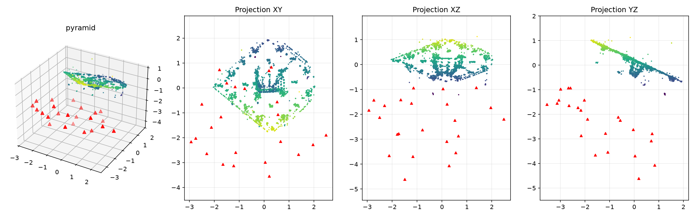

# 3D reconstruction from photos by relative orientation

Turn a series of phone photos of an object into a coloured 3D point cloud, with no
calibration target and no known 3D points. The pipeline is an **incremental
Structure-from-Motion** written in Python with OpenCV, NumPy and SciPy.



This repository holds my part of a team project at IMT Atlantique (2025–2026, team of
five students): the *relative orientation* pipeline. The other parts of the project
(absolute orientation with DLT and LoFTR, Android app) are described in the
[full project report](docs/report_fr.pdf) (in French) but their code is not included here.

## How it works

1. **Features**: SIFT keypoints and descriptors for each image.
2. **Matching**: brute-force matching with Lowe's ratio test (0.75), then RANSAC on the
   fundamental matrix to keep matches that satisfy the epipolar constraint
   `x2ᵀ F x1 = 0`.
   - *Exhaustive* mode tests all `n(n-1)/2` pairs.
   - *Window* mode (`--pair-gap g`) matches each image with its next `g` images only:
     `O(n)` pairs, for long sequences shot around the object.
3. **Initial pair**: the pair with the most inliers. The essential matrix is estimated
   with the known intrinsics (5-point + RANSAC), and `recoverPose` gives `R, t`.
   The first camera is the world frame: `P1 = K [I | 0]`, `P2 = K [R | t]`.
4. **Incremental registration**: the next image is the one that sees the most existing
   3D points. Its pose comes from `solvePnPRansac`, refined with Levenberg–Marquardt.
   New matches are triangulated. A new point is kept only if it is in front of both
   cameras, reprojects within 4 px and has at least 1° of parallax. Matches of an
   already-known point extend its track instead of creating a duplicate.
5. **Bundle adjustment**: all poses and points are refined together (sparse least
   squares, SciPy). This runs each time the model grows by 30 % and once at the end,
   after removing observations that reproject badly.
6. **Export**: the colour of each point is the mean RGB over the images that see it.
   Two binary PLY files are written: the raw cloud and a clean cloud centred on its
   median (95 % closest points).

The camera is an iPhone 13 (focal length ≈ 3028 px at 3024×4032). The focal length is
scaled with the image size, so downscaled or landscape images work too. The result is
up to scale. In the project, the scale was fixed in CloudCompare from one known
distance.

## Results

| Scene | Images | Cameras registered | Notes |
|---|---|---|---|
| Pencil case | 18 | 18/18 | Curved, weakly textured object |
| Pyramid | 23 | 23/23 | Simple shape, used for the accuracy check |
| Stairs | 39 | 39/39 | Many edges, dense cloud |
| Topographic map | 32 (1 in 2) | 32/32 | Very detailed, run with `--pair-gap 2` |

**Accuracy on the pyramid** (after scaling): three known distances of 10, 5 and 2.5 cm
were measured in the cloud, with a **mean relative error of 2.47 %** (1.5 mm).

The final clouds from the project are in [`examples/clouds/`](examples/clouds). Open them
in CloudCompare or MeshLab.

**Effect of bundle adjustment** on the pyramid (23 images):

| | Original script | This version |
|---|---|---|
| Full resolution (3024×4032) | 19,364 points, no error control | 11,063 points, **0.59 px** mean reprojection error, 3.2 min |
| Sample images (1200×1600) | – | 4,973 points, **0.52 px**, 12 s |
| Same, `--no-ba` | – | 4,943 points, 29 px (pose errors add up) |

## Usage

```bash
python -m venv .venv && source .venv/bin/activate
pip install -r requirements.txt

# sample data included in the repository (23 photos of the pyramid, downscaled)
python reconstruct.py data/pyramid -o results/pyramid

# long sequence: one image in two, 2 neighbours per image, images reduced to 2000 px
python reconstruct.py path/to/photos --step 2 --pair-gap 2 --max-size 2000

# another camera: focal length in pixels at a given resolution
python reconstruct.py path/to/photos --focal-px 1450 --ref-size 1920 1080
```

Outputs in the output folder:
- `cloud_rgb.ply`: the raw coloured cloud;
- `cloud_clean_rgb.ply`: the clean cloud, centred on its median;
- `overview.png`: a 3D view and three projections, with the cameras in red;
- `summary.json`: counts, reprojection error, runtime and options.

Tips for taking the photos: move slowly around the object with a lot of overlap
between consecutive photos, and copy them with a USB cable. Messaging apps compress
the images and lower the quality of the matches.

Run the tests (synthetic scene with known cameras: checks pose, shape, absence of
duplicates and that bundle adjustment removes drift):

```bash
pytest -q
```

## Project structure

```
reconstruct.py          command-line entry point
sfm/
  camera.py             intrinsic matrix K
  io.py                 image listing (natural order) and loading
  matching.py           SIFT, ratio test, RANSAC on F, pair selection
  reconstruction.py     initial pair, PnP registration, triangulation, tracks
  bundle_adjustment.py  sparse bundle adjustment (SciPy)
  export.py             point colours, outlier removal, binary PLY
  plotting.py           overview figure
tests/                  synthetic tests (pytest)
data/pyramid/           sample photos (downscaled)
examples/               outputs and final clouds of the project
docs/report_fr.pdf      full project report (French)
```

## Limitations and next steps

- The intrinsics are approximate (no lens distortion model). A chessboard calibration
  would improve accuracy.
- The cloud is sparse (keypoints only). Dense reconstruction (multi-view stereo) and
  meshing would give surfaces.
- The scale is arbitrary. Automatic scaling from a marker (ArUco) of known size would
  replace the manual step in CloudCompare.
- SIFT struggles on uniform surfaces. Learned matchers (LoFTR, LightGlue) were more
  reliable in the absolute-orientation part of the project.
